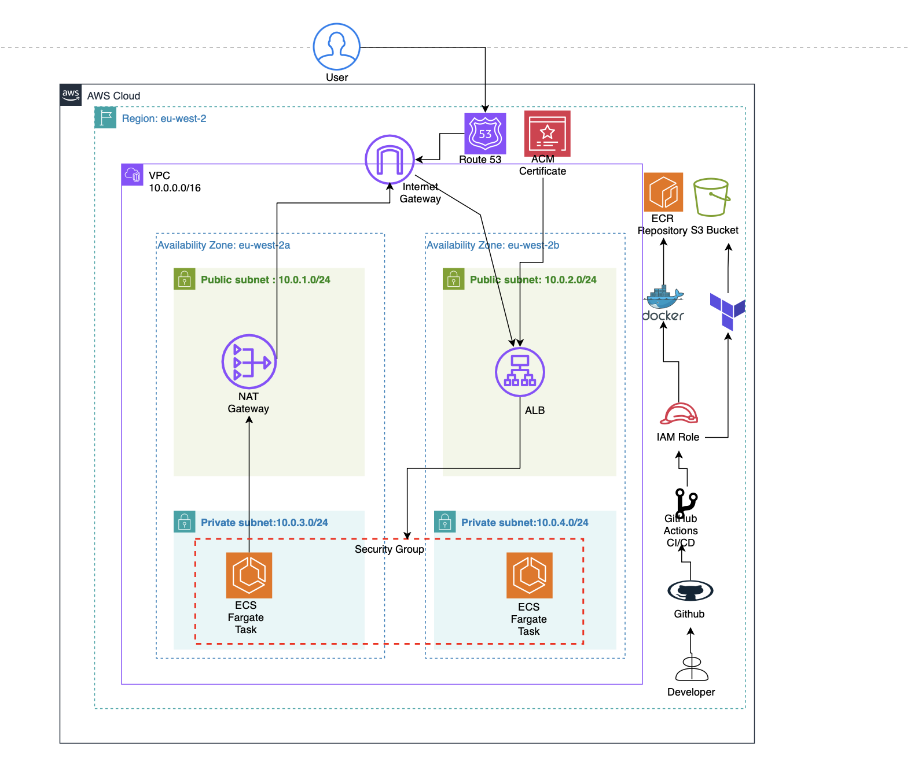
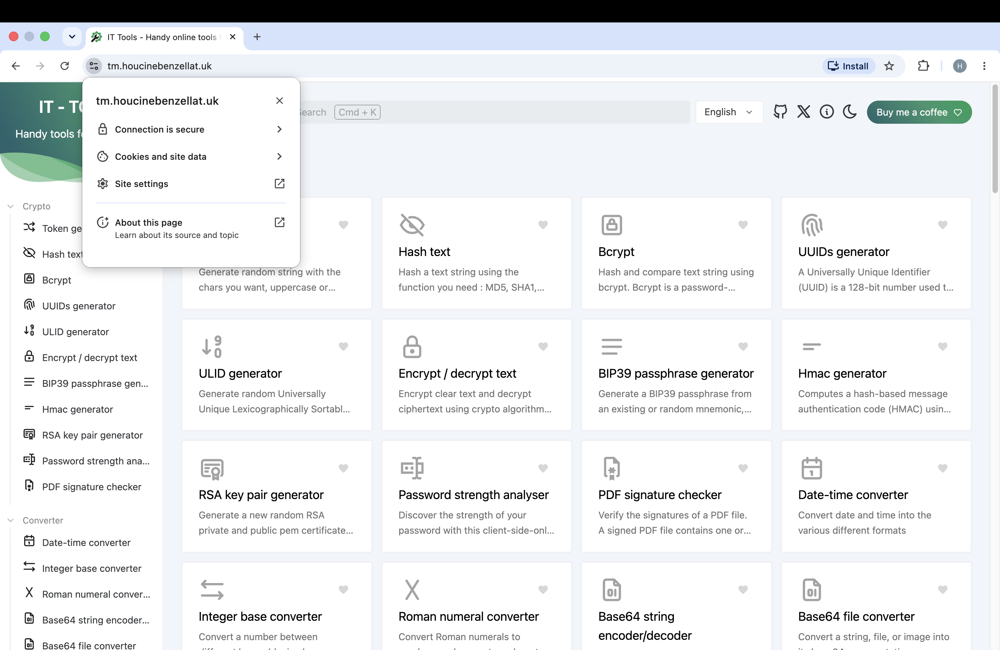
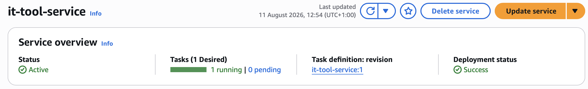
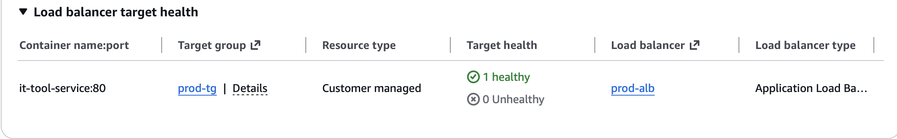
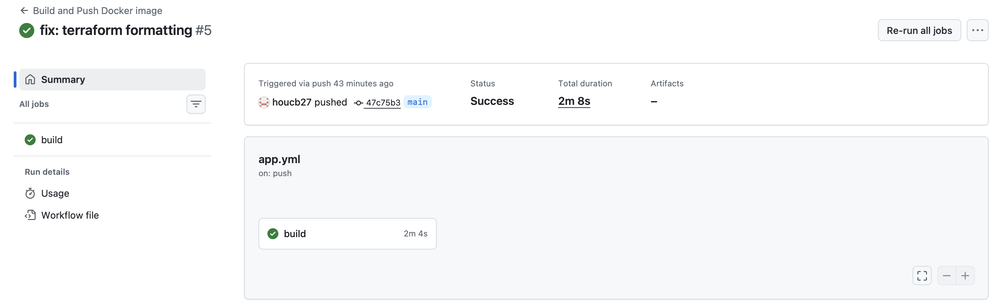
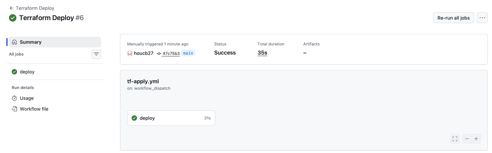
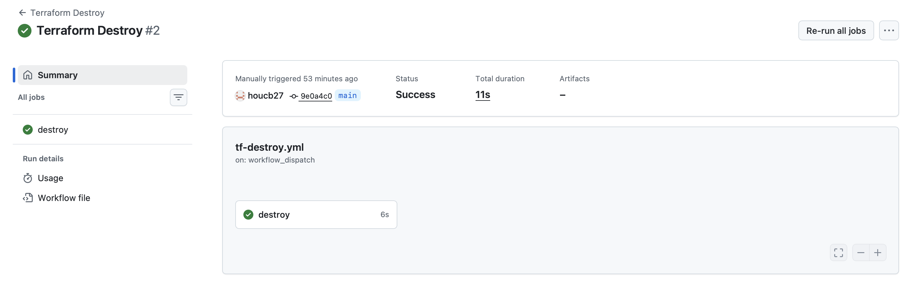

# ECS IT Tools Deployment


---

## What is this project?

This project is a production-grade cloud deployment of [IT Tools](https://github.com/CorentinTh/it-tools) on AWS ECS Fargate, built to demonstrate real-world DevOps engineering — containerisation, infrastructure as code, automated CI/CD, HTTPS, and custom domain routing.

**Live URL:** [https://tm.houcinebenzellat.uk](https://tm.houcinebenzellat.uk)

---

## The Big Four

### 1. What is IT Tools?

IT Tools is an open-source collection of handy utilities for developers — think base64 encoder/decoder, JWT parser, hash generator, UUID generator, colour converter, and 60+ more tools — all accessible from a single clean web interface.

It's built with Vue.js, runs as a single-page application, and is completely client-side — meaning no backend, no database, and no user data is stored. This makes it ideal for containerisation and static serving via nginx.

### 2. Why did I choose this application?

I chose IT Tools for several reasons:

- **No database dependency** — it runs as a single container, keeping the infrastructure clean and focused on ECS, networking, and automation
- **Real utility** — it's a tool developers actually use, making the deployment meaningful rather than a throwaway "hello world"
- **Containerisation challenge** — IT Tools is a Node.js/Vue app that requires a proper multi-stage Docker build (compile assets → serve with nginx), which demonstrates real Docker knowledge
- **Differentiation** — deploying a real open-source tool rather than a sample app makes the project stand out on a CV

### 3. Why ECS? Why not a VM, Vercel, or Netlify?

**Why not Vercel or Netlify?**
Vercel and Netlify are excellent for static sites but they abstract away everything. There's no Docker, no networking, no IAM, no VPC — none of the infrastructure skills employers are hiring for. Deploying to Vercel takes one click and teaches you nothing about cloud infrastructure.

**Why not a VM (EC2)?**
A VM works but you become responsible for the OS — patching, security updates, capacity planning, SSH access management. If the instance goes down, the app goes down. ECS with Fargate handles all of this automatically.

**Why ECS Fargate specifically?**
- **Serverless containers** — no servers to manage. I define CPU and memory requirements and AWS handles placement, scaling, and availability
- **Production pattern** — ECS is how companies run containerised workloads at scale
- **Integration** — native integration with ALB, ECR, IAM, CloudWatch, and ACM makes the full stack work seamlessly
- **Cost efficiency** — pay only for what you use, scale to zero when idle

### 4. Expected users and scale

This deployment is sized for a small to medium internal tool — roughly 10–100 concurrent users. The current configuration runs:

- **1 ECS Fargate task** — 256 CPU units (0.25 vCPU), 512MB RAM
- **1 ALB** across 2 Availability Zones for high availability
- **Private subnets** for security, with NAT Gateway for outbound access

To scale, I would increase `desired_count` in the ECS service, enable Auto Scaling based on ALB request count, or increase task CPU/memory — all via a Terraform variable change with no manual intervention.

---

## Architecture

- Users connect via HTTPS to `tm.houcinebenzellat.uk`
- Route 53 resolves the domain to the Application Load Balancer
- The ALB terminates SSL using an ACM certificate and forwards traffic to ECS on port 80
- ECS Fargate tasks run in private subnets — not directly exposed to the internet
- A NAT Gateway in the public subnet allows tasks to pull Docker images from ECR



---

## Tech Stack

| Technology | Purpose |
|-----------|---------|
| Docker | Multi-stage containerisation (Node builder → nginx runtime) |
| AWS ECS Fargate | Serverless container orchestration |
| AWS ECR | Private Docker image registry |
| AWS ALB | Load balancing and HTTPS termination |
| AWS ACM | Free SSL/TLS certificate with DNS validation |
| AWS VPC | Network isolation — public/private subnets across 2 AZs |
| AWS NAT Gateway | Outbound internet access for private subnet tasks |
| AWS Route 53 | DNS management |
| AWS IAM | OIDC roles with least-privilege policies |
| AWS S3 | Terraform remote state with versioning |
| Terraform | Infrastructure as Code with 6 modular configs |
| GitHub Actions | CI/CD pipelines with OIDC — no static AWS keys |

---

## Infrastructure

All infrastructure is defined as Terraform code, split into 6 focused modules:

infra/
├── main.tf # Module orchestration
├── variables.tf # Input variables
├── outputs.tf # ALB DNS, ECR URL, cluster name
├── provider.tf # AWS provider + S3 backend
└── modules/
├── vpc/ # VPC, subnets, IGW, NAT Gateway, route tables
├── ecr/ # Elastic Container Registry
├── iam/ # Task execution role and ECS policies
├── acm/ # SSL certificate with DNS validation
├── alb/ # ALB, listeners (HTTP→HTTPS redirect), target group
└── ecs/ # Cluster, task definition, service, security groups


Terraform state is stored in S3 with versioning enabled — any accidental destroy can be recovered from a previous state version.

---

## CI/CD Pipelines

Three GitHub Actions pipelines automate the full deployment lifecycle:

| Pipeline | Trigger | What it does |
|---------|---------|-------------|
| **App Pipeline** | Push to `main` | Builds Docker image, tags with commit SHA, pushes to ECR |
| **Terraform Apply** | Push to `infra/**` | `fmt` → `validate` → `plan` → `apply` |
| **Terraform Destroy** | Manual only (`workflow_dispatch`) | Safely tears down all infrastructure |

All pipelines authenticate to AWS using **OIDC** — GitHub requests temporary credentials from AWS at runtime. No access keys are stored anywhere.

---

## Project Structure

ecs-it-tools/
├── app/ # IT Tools source code (Vue.js)
├── Dockerfile # Multi-stage build: Node → nginx
├── .dockerignore
├── nginx.conf # SPA routing config
├── infra/ # Terraform
│ ├── modules/
│ │ ├── vpc/
│ │ ├── ecr/
│ │ ├── iam/
│ │ ├── acm/
│ │ ├── alb/
│ │ └── ecs/
│ ├── main.tf
│ ├── variables.tf
│ ├── outputs.tf
│ └── provider.tf
├── .github/
│ └── workflows/
│ ├── app.yml
│ ├── tf-apply.yml
│ └── tf-destroy.yml
├── screenshots/
└── README.md


---

## Local Setup

### Prerequisites

- Docker Desktop
- AWS CLI configured
- Terraform >= 1.0

### Run locally

```bash
git clone https://github.com/houcb27/ecs-it-tools
cd ecs-it-tools

docker build -t it-tools .
docker run -p 80:80 it-tools

# Visit http://localhost:80
```

### Deploy infrastructure

```bash
cd infra
terraform init
terraform plan
terraform apply
```

---

## Screenshots

### App Live at https://tm.houcinebenzellat.uk


### ECS Service — Running Tasks


### Target Group — Healthy


### App Pipeline — Docker Build & Push


### Terraform Apply Pipeline


### Terraform Destroy Pipeline


---

## Key Decisions

**Why private subnets for ECS tasks?**
Containers are not directly reachable from the internet. All traffic must flow through the ALB, which acts as the single entry point. This reduces the attack surface significantly.

**Why OIDC instead of AWS access keys?**
OIDC tokens are short-lived and scoped to a specific repo and branch. Even if intercepted, they expire within minutes. Access keys are permanent and a serious security risk if leaked.

**Why Terraform modules instead of a single file?**
Each module owns one concern — VPC, ECS, ALB, etc. This makes the codebase easier to reason about, test independently, and reuse across projects.

**Why NAT Gateway over public subnet ECS tasks?**
Running tasks in private subnets is industry best practice. The NAT Gateway allows outbound traffic (ECR image pulls, CloudWatch logs) without exposing the containers directly to the internet.

---

